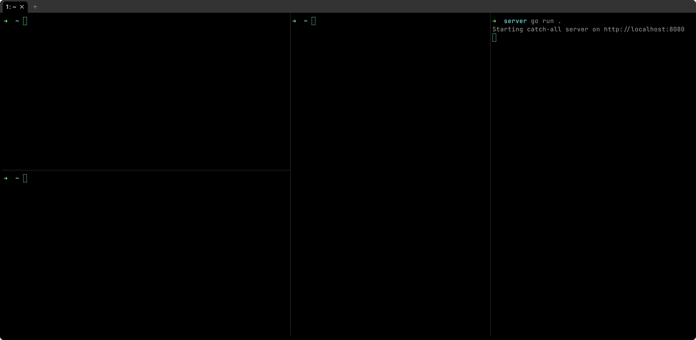

# AhaSend CLI

[](https://go.dev/)
[](https://goreportcard.com/report/github.com/AhaSend/ahasend-cli)
[](https://ahasend.com/docs/api-reference)
[](https://opensource.org/licenses/apache-2.0)

A powerful command-line interface for [AhaSend](https://ahasend.com), the reliable transactional email service. Send emails, manage domains, configure webhooks, and monitor email analytics directly from your terminal.



## Features

- **🚀 Email Sending**: Send single or batch emails with templates, attachments, and scheduling
- **🌐 Domain Management**: Add, verify, and manage sending domains with DNS configuration
- **🔔 Webhook Management**: Configure, test, and monitor real-time event notifications
- **🔐 Authentication**: Secure profile-based authentication with API key management
- **👥 Sub-Account Management**: Provision, suspend, and review usage for sub-accounts and their nested API keys
- **👤 Contact and List Management**: Create, update, batch upsert, and safely delete contacts, and manage the lists they belong to
- **📝 Transactional Templates**: Store, draft, publish, and restore versions of the templates `messages send --template-id` sends
- **📣 Marketing Campaigns**: Draft, test, send or schedule, and report on campaigns to contact lists, and manage campaign templates
- **📊 Analytics**: Comprehensive email statistics and reporting
- **📦 Batch Processing**: High-performance concurrent operations with progress tracking
- **🎨 Multiple Output Formats**: JSON, table, CSV, and plain text
- **🐛 Debug Mode**: Detailed request/response logging for troubleshooting

## 📚 Documentation

For comprehensive details, visit the [official Ahasend CLI documentation](https://ahasend.com/docs/cli).

### Key Resources:
- [Installation Instructions](https://ahasend.com/docs/cli/installation) - Steps to install and configure
- [Quickstart Guide](https://ahasend.com/docs/cli/quickstart) - Get up and running in minutes
- [Usage Examples](https://ahasend.com/docs/cli/examples) - Explore common use cases and command examples

## Installation

### From Source

```bash
# Clone the repository
git clone https://github.com/AhaSend/ahasend-cli.git
cd ahasend-cli

# Build the CLI
make build

# Install to your PATH
sudo cp ./bin/ahasend /usr/local/bin/

# Verify installation
ahasend --help
```

### Binary Installation

Download the latest binary for your platform from the [releases page](https://github.com/AhaSend/ahasend-cli/releases).

```bash
# Linux/macOS
chmod +x ahasend
sudo mv ahasend /usr/local/bin/

# Verify installation
ahasend --version
```

## Quick Start

### 1. Authentication

```bash
# Interactive login
ahasend auth login

# Or provide credentials directly
ahasend auth login --api-key YOUR_API_KEY --account-id YOUR_ACCOUNT_ID
```

### 2. Add a Domain

```bash
# Add a domain for email sending
ahasend domains create example.com

# Check the DNS records after configuring them
ahasend domains check-dns example.com
```

### 3. Send an Email

```bash
# Simple text email
ahasend messages send \
  --from noreply@example.com \
  --to user@recipient.com \
  --subject "Hello from AhaSend" \
  --text "Welcome to AhaSend!"

# HTML email with template
ahasend messages send \
  --from noreply@example.com \
  --to user@recipient.com \
  --subject "Welcome {{name}}" \
  --html-file welcome.html \
  --global-substitutions data.json
```

#### Email testing with Sandbox

You can include `--sandbox` to send the email in [sandbox mode](https://ahasend.com/docs/send-api/sandbox).  Sandbox mode simulate the entire email sending process without actually delivering emails to recipients. It’s the perfect solution for testing your API integration safely, testing webhook workflows, and developing email features without worrying about costs or accidental sends.

```bash
# Simple text email
ahasend messages send \
  --from noreply@example.com \
  --to user@recipient.com \
  --subject "Hello from AhaSend" \
  --text "Welcome to AhaSend!" \
  --sandbox
```

### 4. Send Batch Emails

```bash
# High-performance batch sending
ahasend messages send \
  --from noreply@example.com \
  --recipients users.csv \
  --subject "Welcome to AhaSend" \
  --html-file welcome.html \
  --max-concurrency 5 \
  --progress
```

### 5. Test Webhooks & Inbound Routes

```bash
# Stream outbound email webhook events in real time and forward them locally
ahasend webhooks listen \
  --events "message.delivered,message.opened,message.clicked" \
  --forward-to http://localhost:8080/webhook

# Trigger test webhook events
ahasend webhooks trigger abcd1234-5678-90ef-abcd-1234567890ab \
  --events "message.delivered,message.opened"

# Listen for inbound email route events
ahasend routes listen --recipient "*@example.com" \
  --forward-to http://localhost:3000/webhook

# Trigger a test route event
ahasend routes trigger <route-id>
```

## Command Reference

### Core Commands

| Command | Description |
|---------|-------------|
| `auth` | Manage authentication and profiles |
| `campaigns` | Draft, test, send and report on marketing campaigns, and manage campaign templates |
| `contacts` | Manage account-global contacts and their list memberships |
| `domains` | Manage sending domains, their sending type and DKIM selector |
| `lists` | Manage contact lists and their members |
| `messages` | Send and manage email messages, inline or from a stored template |
| `templates` | Manage transactional templates, their drafts and published versions |
| `webhooks` | Configure webhook endpoints |
| `suppressions` | Manage suppression lists |
| `stats` | View email statistics |
| `apikeys` | Manage API keys and their IP allow lists |
| `subaccounts` | Manage sub-accounts, their nested API keys and paused domains |
| `smtp` | SMTP credentials and testing |
| `routes` | Email routing rules |
| `ping` | Test API connectivity |
| `completion` | Print the shell completion script for `bash`, `zsh`, `fish` or `powershell` |

### Contact and List Management

Contact commands operate on account-global contacts and do not create list
memberships. Attribute keys are defined in the AhaSend dashboard under the
contact attribute settings; configure a key there before supplying it in
`--attributes` or a batch file.

```bash
# Create and retrieve a contact. Pass email addresses raw, including '+'.
ahasend contacts create 'user+tag@example.com' --first-name Pat \
  --attributes '{"plan":"pro"}' --idempotency-key create-user-tag
ahasend contacts get 'user+tag@example.com'

# Stop mail while retaining the contact and its history.
ahasend contacts update 'user+tag@example.com' --unsubscribed=true

# Synchronously upsert up to 1,000 contacts.
ahasend contacts batch --file contacts.json --idempotency-key import-2026-09-11
```

Supply UUIDs or raw email addresses to `get`, `update`, `delete` and `memberships`;
do not percent-encode an email yourself. The SDK percent-encodes the path
segment exactly once.

A batch file holds at most 1,000 contacts, duplicates included. Batch
completion time depends on the data and account. Measure completion time in
your environment and pace successive batches from that observed duration
instead of assuming a fixed request rate. Give each logical batch a stable
idempotency key, and reuse that key only to retry the identical payload.
`contacts batch`, `lists members add` and `campaigns test` print each item's
outcome and exit with code 1 when any item failed.

Deleting a contact cancels active workflows (while retaining cancelled-workflow
audit rows) and erases unsubscribe, membership, campaign, open, and click
history. Prefer `contacts update <id-or-email> --unsubscribed=true` when the goal
is only to stop mail.

Lists group contacts for campaigns. Contacts must exist before they are added
to a list:

```bash
ahasend lists create --name Newsletter --tag news
ahasend lists members add <list-id> --email a@example.com --email b@example.com
ahasend lists members list <list-id> --include-contacts
ahasend contacts memberships a@example.com
```

API keys need the `contacts:read`, `contacts:write` and `contacts:delete`
scopes for the contact commands, and `lists:read`, `lists:write` and
`lists:delete` for the list commands; `contacts memberships` needs
`lists:read`, and `lists members list --include-contacts` also needs
`contacts:read`.

### Transactional Templates

Template changes go to a draft; sends use the published copy, so publish before
sending. `messages send --template-id` sends a stored template, and copies
`--global-substitutions` into every recipient's substitutions:

```bash
ahasend templates create --name Welcome --mjml-file welcome.mjml \
  --from hello@example.com --publish
ahasend templates update <template-id> --subject "Welcome aboard" --publish
ahasend templates versions list <template-id>
ahasend messages send --template-id <template-id> --recipients users.csv
```

The template commands, and the campaign template commands, need the
`templates:read`, `templates:write` and `templates:delete` scopes. Sending a
template needs only the usual send scope.

### Campaigns

Campaigns send a design to contact lists. Test a draft, then send it now or
schedule it; a draft with issues is refused, and each issue is listed:

```bash
ahasend campaigns create --name "October news" --subject "What's new" \
  --from news@example.com --list-id <list-id> --html-file october.html
ahasend campaigns test <campaign-id> --to me@example.com
ahasend campaigns send <campaign-id> --schedule 2026-11-01T09:00:00Z
ahasend campaigns stats <campaign-id>
```

The campaign commands need `campaigns:read` to read campaigns, their stats
and recipients, `campaigns:write` to create, update and duplicate them,
`campaigns:delete` to delete them, and `campaigns:send` to send, unschedule
and test them.

### Global Flags

```bash
--api-key        # Use this API key instead of a profile (production API; not with --profile)
--account-id     # Account ID of --api-key (only with --api-key, which needs it)
--profile        # Use specific profile
--output         # Output format (json, table, csv, plain; default plain)
--no-color       # Turn off colors
--verbose        # Enable verbose logging
--debug          # Enable debug logging with HTTP details (secrets redacted)
--help           # Show help for any command
```

[Global Flags](USAGE.mdx#global-flags) says when the output has colors.

### Scripting

- `--output json` prints the API's response body unchanged, for successes and
  errors alike. Commands that call the API once per item, such as
  `messages cancel` with several IDs, print a JSON array with one response per
  call.
- Every failure exits nonzero. API errors exit by HTTP status: 401 exits 2,
  400 and 422 exit 4, 404 exits 5, 403 exits 6, 429 exits 8, and other
  statuses exit 1. Invalid input and command-line mistakes exit 4, an unknown
  profile, a missing default profile, a profile's bad `api_url`, empty
  `api_key` or non-UUID `account_id`, or an unreadable configuration file
  exits 3, a network failure, including a
  dropped `webhooks listen` or `routes listen` stream or an SMTP server that
  closed the connection, exits 7, a command with failed items or output it
  could not write, such as to a pipe closed early, exits 1, and
  `messages send`, or `messages cancel` of several messages, stopped by
  Ctrl+C or SIGTERM exits 130 after it reports what it did.
- Commands that delete, overwrite, cancel or suspend, `campaigns send` and
  `auth logout --all` ask for confirmation on stderr (the list is in
  [USAGE.mdx](USAGE.mdx#confirmation-prompts)); declining, or a stdin that
  ends or cannot be read, exits 4. Pass `--force` (`-f`) in scripts.
  `messages send` and `smtp send` send without asking for confirmation.
- A request that failed with HTTP 429, a 5xx status or a network error is
  sent again as [Rate Limiting](USAGE.mdx#rate-limiting) describes, which
  also lists the requests that are sent only once.
- Table and plain list output end with the `--after <cursor>` and
  `--before <cursor>` flags that fetch the next and previous pages; CSV
  output has no cursor line.
- `messages send` saves the recipients that failed, or were not sent because
  the send was interrupted, to a new file in `~/.ahasend/` and prints its path
  on stderr, so a script can pass it back to `--recipients`. Recipients whose
  request may have reached the API without an answer, such as one the API
  was still processing or that timed out, go to a separate `unknown-*.json`
  file, since they may have been sent; stderr names the idempotency key that
  sends them again safely within 24 hours, and the time a relative
  `--schedule` stood for, to pass in its place.

See [USAGE.mdx](USAGE.mdx) for the full rules.

## Examples

### Sending Emails with Templates

```bash
# Create a template file
cat > welcome.html << EOF
<!DOCTYPE html>
<html>
<body>
    <h1>Welcome {{first_name}}!</h1>
    <p>Thank you for joining {{company_name}}.</p>
</body>
</html>
EOF

# Create the substitution data
echo '{"first_name": "John", "company_name": "ACME Corp"}' > data.json

# Send with substitutions
ahasend messages send \
  --from noreply@company.com \
  --to user@example.com \
  --subject "Welcome to {{company_name}}" \
  --html-file welcome.html \
  --global-substitutions data.json
```

### Batch Processing with CSV

`recipients.csv`:

```csv
email,name,first_name,account_type
john@example.com,John Doe,John,premium
jane@example.com,Jane Smith,Jane,basic
```

```bash
ahasend messages send \
  --from noreply@example.com \
  --recipients recipients.csv \
  --subject "Account Update for {{first_name}}" \
  --html-file notification.html \
  --max-concurrency 5 \
  --progress
```

### Managing Multiple Environments

```bash
# Set up profiles for different environments
ahasend auth login --profile production
ahasend auth login --profile staging

# Use specific profile for commands
ahasend messages send --profile staging \
  --from test@staging.com \
  --to dev@example.com \
  --subject "Test" \
  --text "Testing staging environment"

# Switch default profile
ahasend auth switch production
```

### Webhook Development and Testing

```bash
# Configure a webhook endpoint for every domain
ahasend webhooks create \
  --name "Production webhook handler" \
  --url https://api.example.com/webhooks/ahasend \
  --scope global \
  --events "delivered,bounced,failed"

# Stream events in real time and forward them to a local handler
ahasend webhooks listen --forward-to http://localhost:3000/webhook

# Trigger test events for integration testing
ahasend webhooks trigger <webhook-id> \
  --all-events

# List all configured webhooks
ahasend webhooks list --output table
```

### Inbound Email Route Testing

```bash
# Listen for inbound emails with temporary route
ahasend routes listen --recipient "*@example.com" \
  --forward-to http://localhost:3000/webhook

# Listen with existing route and slim output
ahasend routes listen --route-id <route-id> \
  --slim-output

# Test route processing without real emails
ahasend routes trigger <route-id>

# Create and test a support email route
ahasend routes create \
  --name "Support" \
  --url https://api.example.com/inbound/support \
  --recipient "support@example.com"

ahasend routes listen --recipient "support@example.com" \
  --forward-to http://localhost:8080/support-webhook
```

### Monitoring and Analytics

```bash
# View delivery statistics
ahasend stats deliverability \
  --from-time 2026-01-01T00:00:00Z \
  --to-time 2026-02-01T00:00:00Z \
  --group-by day

# Check bounce rates
ahasend stats bounces --group-by day

# Export stats to CSV
ahasend stats deliverability --output csv > stats.csv
```

## Configuration

Configuration is stored in `~/.ahasend/config.yaml`:

```yaml
default_profile: production
profiles:
  production:
    api_key: "your-api-key"
    account_id: "your-account-id"
    api_url: "https://api.ahasend.com"
```

Saving the file keeps the keys the CLI does not know, but not comments. The file holds your API
keys, so the CLI keeps it, and `~/.ahasend`, readable by your user only.
Profile names keep their case and dots, and no environment variable overrides
the file. Commands that change the file lock it and replace it in one step,
so commands run at once never lose each other's changes; a `config.yaml`
that is a symlink stays one. An `api_url` must be an HTTP or HTTPS URL with a
host, and no path, user name or password, an `api_key` must not be empty, and
an `account_id` must be a UUID; another value fails with exit code 3. An `http://` `api_url` to another machine sends the API key
unencrypted, so every command that uses such a profile warns on stderr.

## Output Formats

The CLI supports multiple output formats:

- **Plain** (default): Simple key-value format
- **Table**: Human-readable formatted tables
- **JSON**: Machine-readable for automation
- **CSV**: For data export and analysis; values are written as the API sent
  them, so import a file whose content comes from others into a spreadsheet
  as text, since a value starting with `=`, `+`, `-` or `@` can read as a
  formula

```bash
# Examples
ahasend domains list                # Plain format
ahasend domains list --output table # Table format
ahasend domains list --output json  # JSON format
ahasend stats bounces --output csv  # CSV format
```

## Development

### Prerequisites

- Go 1.26 or higher. `go.mod` names Go 1.27.2 as its toolchain, which the
  `go` command downloads when yours is older, so every build uses the same
  release as CI, the release binaries and the Docker image
- Make

### Building from Source

```bash
# Clone the repository
git clone https://github.com/AhaSend/ahasend-cli.git
cd ahasend-cli

# Install dependencies
go mod download

# Run tests
make test

# Build binary
make build

# Run linter, on the Windows-only files too
make lint
```

`make check-go-version` checks that the Dockerfile and the workflows use the
toolchain of `go.mod`; change all of them together.

### Third-Party Notices

`THIRD_PARTY_NOTICES` holds the licence notices of the Go standard library and
of every module built into the binary; releases and the Docker image ship it.
After a change to the dependencies or to the Go toolchain, regenerate it with
`make notices`, which reads the notices from the module cache with the Go
toolchain alone, and commit the result. Both targets run with the Go release
of the `toolchain` line of `go.mod`, which the go command downloads when it
is not the one installed, since a Go a distribution packaged may keep the
standard library's licence outside its GOROOT. CI and the release workflow
run `make notices-check`, which fails when the file is out of date, or with
the script's own error, such as a module without a licence file.

### Project Structure

```
ahasend-cli/
├── cmd/                    # Command implementations
│   ├── root.go            # Root command
│   └── groups/            # Command groups
│       ├── auth/          # Authentication commands
│       ├── domains/       # Domain management
│       ├── messages/      # Message sending
│       └── ...
├── internal/              # Internal packages
│   ├── client/           # API client wrapper
│   ├── config/           # Configuration management
│   ├── printer/          # Output formatting
│   └── ...
├── docs/                  # Images for this README
├── test/                  # Integration tests
└── Makefile              # Build automation
```

### Running Tests

```bash
# Run all tests
make test

# Run unit tests only
make test-unit

# Run integration tests
make test-integration

# Run with coverage
make test-coverage
```

## Contributing

We welcome contributions:

1. Fork the repository
2. Create your feature branch (`git checkout -b feature/amazing-feature`)
3. Commit your changes (`git commit -m 'Add amazing feature'`)
4. Push to the branch (`git push origin feature/amazing-feature`)
5. Open a Pull Request

## Documentation

- [Full CLI Documentation](USAGE.mdx)
- [AhaSend API Documentation](https://ahasend.com/docs/api-reference)
- [AhaSend Website](https://ahasend.com)

## Support

- **Issues**: [GitHub Issues](https://github.com/AhaSend/ahasend-cli/issues)
- **Email**: support@ahasend.com
- **Documentation**: [ahasend.com/docs](https://ahasend.com/docs)

## License

This project is licensed under the Apache License 2.0; see the [LICENSE](LICENSE) file for details.

## Acknowledgments

Built with:
- [Cobra](https://github.com/spf13/cobra) - CLI framework
- [AhaSend Go SDK](https://github.com/AhaSend/ahasend-go) - API client

---

Made with ❤️ by the AhaSend team
